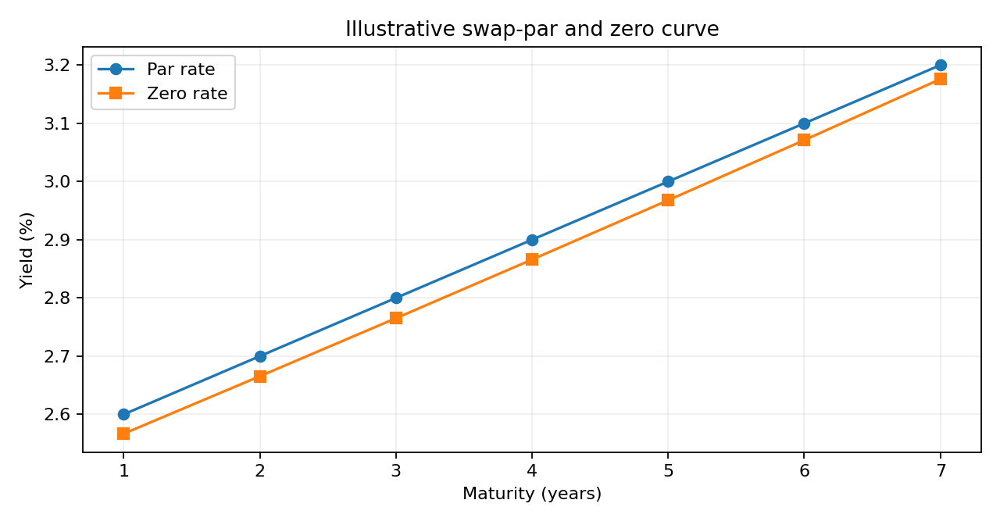

# Rates & FX Pricing, Curves & Risk Analytics (Python)

**Front-office-oriented analytics**: bootstrap annual-pay **par swap** curve discount factors and continuously compounded zero rates; reprice par swaps; mark fixed-rate bonds and calculate symmetric DV01; mark simplified receive-fixed swaps; apply covered interest parity to EUR/USD forward rates and mark-to-market; examine interest-rate / FX stress scenarios.



*Model-generated synthetic example, not live-market results.*

## Run

```bash
python -m pip install -e '.[dev]'
python -m pytest -q
python examples/run_demo.py
streamlit run app.py
```

## Input market conventions

- `data/par_swap_curve_example.csv`: 1y, 2y, ... annual fixed par swap rates in **decimal**. This curve is *synthetic*, not actual market swap quotes. A real-world setup would distinguish OIS discounting and IBOR/term-rate projection, payment frequencies, day counts, calendars, stubs, basis and collateral.
- `bond_dv01` reports quote-currency price reduction for a +1bp **parallel instantaneous zero-curve shock** (central difference); maturity integer annual years.
- `EUR/USD`: USD quote per 1 EUR, EUR is base; fair forward `S * exp((r_USD - r_EUR)T)`. Long base forward PV is USD. Discount rates continuous.
- Optional [ECB historical EUR/USD fixing](https://data.ecb.europa.eu/help/api/data-examples) and [FRED historical US Treasury yields](https://fred.stlouisfed.org/help/data/downloading/using-the-download-data-link) are **real publicly sourced reference series**, but **not swap/OIS par market inputs**. No historical OIS curve is inferred from Treasury rates.

## Limitations

No multi-curve discounting, bootstrapping deposits/futures, USD/EUR cross-currency basis, CSA discounting, convexity, CVA, bid-ask or liquidity. This is a research/demo, not production pricing.

**CV description:** *Modeling yield curves, bond DV01, FX forwards and mark-to-market under rates / FX shocks.*
